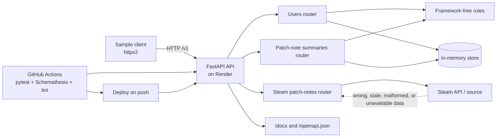

# The pitch

This is for users who want to read about the newest updates to their favorite games. It does this by extracting text and images from game patch note articles and displays them in a Discord channel. One issue that could go wrong for users is if they are unauthorized to extract the patch note information due to authentication issues with the website.

# Scope

Allow users to request patch notes information from sources like Steam and create their own summaries based on said patch notes. For Milestone 2: Everything in the `openapi.yaml`. One thing that may be a strech to complete this semister is user authentication and sessions within the API.

# Users

Primary Users: Gamers and people who want to see patch notes from their favorite games and write summaries on these patch notes to share with others.

Forgotton Users: Users who wish to generate summaries off of other users summaries, this may not work if users can only access their own summaries

# The failure that matters

The highest-risk operation is
`GET /v1/steam-patch-notes?game_id={game_id}`. If the upstream source returns
the wrong game, stale content, malformed data, or becomes unavailable, the
failure reaches the gamer as misleading patch notes or a clear
`application/problem+json` error. The implementation therefore validates the
game identifier, returns a stable `SteamPatchNote` shape, encodes the
outbound URL safely, and reserves `503 Service unavailable` for an upstream
failure. The Steam operation is marked as the risk point in the architecture
sketch below. Summary creation also protects users from duplicate summaries
with a `409 Conflict`.

# Resources and operations

The complete request, response, parameter, and error contract is maintained
in [`openapi.yaml`](../openapi.yaml). The v1 resources are:

| Resource | Operations |
|---|---|
| Users | `GET /v1/users`, `POST /v1/users`, `GET /v1/users/{user_id}` |
| Patch-note summaries | `GET /v1/patch-note-summaries?game_id=...`, `POST /v1/patch-note-summaries`, `GET /v1/patch-note-summaries/{summary_id}?game_id=...`, `DELETE /v1/patch-note-summaries/{summary_id}` |
| Steam patch notes | `GET /v1/steam-patch-notes?game_id=...` |

Create operations return `201 Created` and a `Location` header. Delete
returns `204 No Content`. Invalid requests produce `400`, missing resources
produce `404`, duplicate or conflicting writes produce `409`, unexpected
failures produce `500`, and the Steam operation can report upstream
`503 Service unavailable`. Optional summary fields are omitted when absent.

# Architecture sketch

The store is currently process-local, so data is lost when the service
restarts. The failure marked at the Steam boundary is handled by the router
and exposed through the documented problem-details format rather than
returning an unstructured upstream exception.

# What changed since the pitch

- The original pitch described a Discord-facing extractor; implementation
  work narrowed v1 to a versioned HTTP API with explicit users, summaries,
  and Steam patch-note resources.
- The OpenAPI contract now defines request/response schemas, descriptions,
  status codes, error responses, examples, and the `/v1` compatibility
  policy.
- FastAPI routers, Pydantic models, in-memory storage, duplicate checks, and
  human-readable problem-details responses were added.
- Authentication and session endpoints were removed from the active v1
  implementation and deferred to v2, reducing security and scope risk.
- Contract tests, drift checks, unit tests, a sample client, Makefile
  commands, and CI/deployed smoke checks were added.

# Plan and risks

**By Milestone 2 (Nov 22):**

- Keep all v1 operations aligned with the OpenAPI contract.
- Keep `python -m pytest -q`, Schemathesis, OpenAPI lint, and deployed smoke
  green in CI.
- Keep `/docs`, `/openapi.json`, the README, and the sample client usable.
- Validate the Steam retrieval and summary conflict behavior against the
  documented error shapes.

**By the final (Dec 4):**

- Replace the in-memory store with durable storage and migrations.
- Integrate the real Steam source with timeout, retry, caching, and
  upstream-error handling.
- Revisit authentication and authorization as a v2 feature.
- Add observability and stronger data-quality checks for patch-note content.

**Risks and mitigations:**

1. The in-memory store loses data on restart. Keep the store behind a small
   interface and replace it with durable persistence before final delivery.
2. Steam content or availability may change. Validate the response shape,
   encode identifiers safely, add timeouts/retries, and return `503` when the
   dependency cannot provide data.
3. Contract changes can break clients. Treat `openapi.yaml` as the source of
   truth, run drift and Schemathesis tests in CI, and preserve the `/v1`
   compatibility promise.
